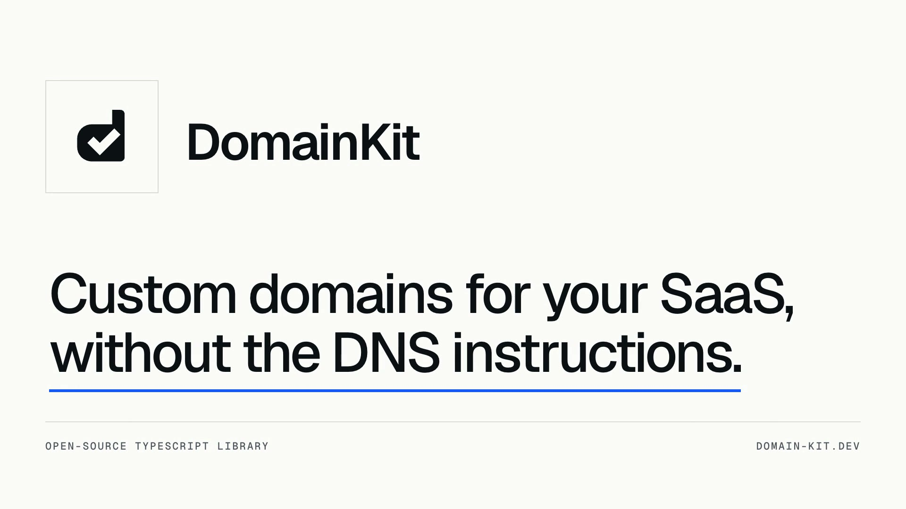
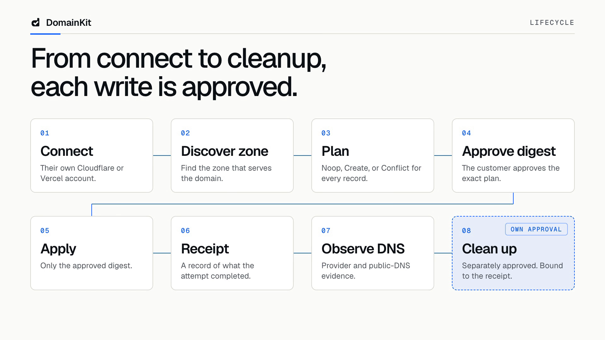
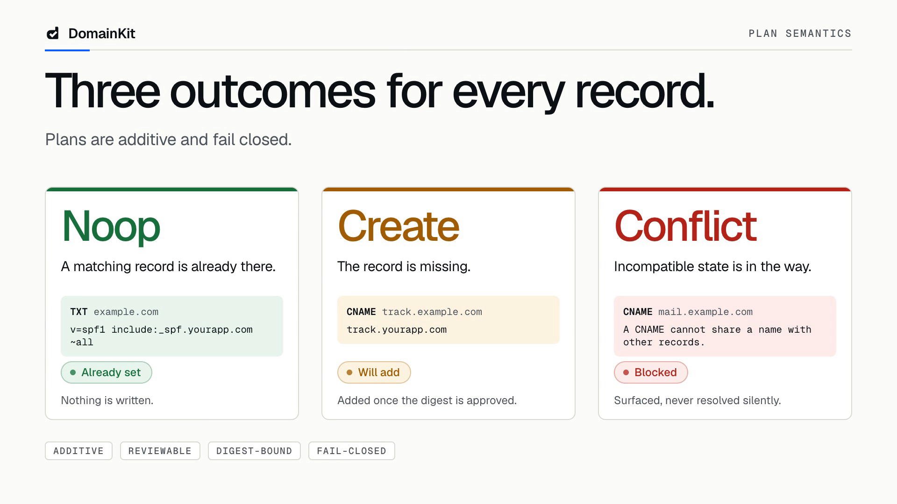

# DomainKit

[](https://www.npmjs.com/package/domainkit)
[](./LICENSE)
[](https://domain-kit.dev)

An open-source TypeScript library for custom domains in SaaS: it sets up a customer's DNS records
through their own Cloudflare or Vercel account. Docs, guides, and components are at
[domain-kit.dev](https://domain-kit.dev), and you can ask questions about the code on
[DeepWiki](https://deepwiki.com/AryaLabsHQ/domainkit).

[](https://domain-kit.dev/#film)

[Watch the 60-second intro](https://domain-kit.dev/#film).

DomainKit turns your product's DNS requirements into a plan a customer can review, applies only the
plan digest they approved, keeps a receipt of every write, and plans cleanup from that receipt.
Cloudflare and Vercel are built in, and a provider is one declarative value.



Plans are additive and fail closed: missing records are created, exact records are no-ops, and
incompatible state is a conflict rather than an overwrite. `DnsRecord.spf` declares an SPF record
that coexists with unrelated TXT and conflicts with a different or duplicate SPF record.



Your app keeps identity, tenancy, credentials, storage, routes, consent, and audit. DomainKit
supplies the lifecycle, not a hosted control plane.

Samva sets up customer domains with DomainKit. Read
[how Samva sets up customer domains](https://domain-kit.dev/customers/samva).

## Packages

- [`domainkit`](./packages/domainkit/README.md) — the Effect-native lifecycle, its host seams, the
  providers, and the values. `domainkit/server` mounts the routes, `domainkit/client` calls them
  from the browser, and `domainkit/testing` ships the fakes and conformance runners.
- [`@domainkit/react`](./packages/react/README.md) — React 19 flows over a transport your server
  owns.
- [`@domainkit/capsuledb`](./packages/capsuledb/README.md) — `Storage` on PostgreSQL as one
  declarative CapsuleDB capsule.

## Repository

- `apps/docs` — the documentation site and the interactive component catalog, published at
  [domain-kit.dev](https://domain-kit.dev).
- `examples` — the snippets the site renders, typechecked against the built packages.
- `packages/domainkit/examples` — runnable Effect examples the core package's own checks gate.

## Development

Use the Bun version pinned in `package.json` (1.4.2) and Node.js 24.10 or newer:

```sh
bun install --frozen-lockfile
bun run check
bun run build
bun run test:artifact
bun run docs:check
```

`bun run release:check` runs all validation serially. `release:version` prepares Tegami metadata;
`release:publish` runs the gated version-PR and publication path used on `main`.
[CONTRIBUTING.md](./CONTRIBUTING.md) covers setup, command contracts, and release behavior.

## Built with DomainKit

If your product uses DomainKit, you can show it in your README:

```md
[](https://domain-kit.dev)
```

## License

[MIT](./LICENSE)
